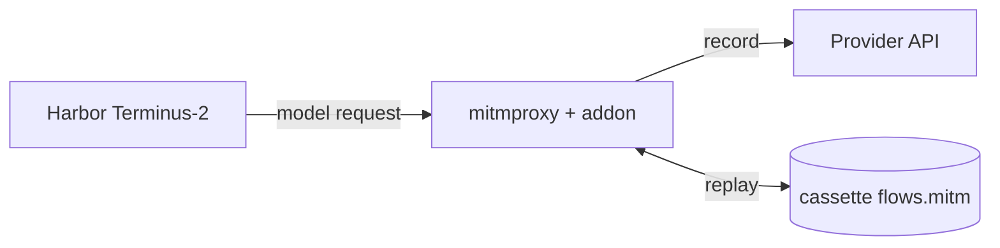

# agent-mitm-replay

Record an agent's model calls, validate the trace once, then measure offline replays.

`agent-mitm-replay` puts a [mitmproxy](https://mitmproxy.org/) reverse proxy between the agent and the model provider. It currently drives [Harbor](https://github.com/harbor-framework/harbor) Terminus-2 trials.

- **record**: requests go to the real provider; the responses are saved to a cassette.
- **validate**: replay offline once; require task success, full response consumption, and the same command trajectory, then mark the cassette accepted.
- **replay**: measure Harbor completion time using an accepted cassette, without repeating command or reward validation.

Use it to compare task-data filesystems/NAS mounts under a fixed model-response sequence. The task, container, terminal commands, verifier, and filesystem run for real each time. The verifier still contributes work and time during measurements, but its reward is not rechecked.

The proxy returns response N for model call N, even when terminal output or the prompt differs. It never falls back to the provider; exhaustion and recorded redirects get HTTP 400. This assumes all model calls go through the proxy; see [Design and limitations](docs/design.md).



## Requirements

- Linux or macOS
- Python 3.13.x
- Docker with Compose v2, for local Harbor environments
- A model reachable through an OpenAI-compatible Chat Completions API (model names start with `openai/`)
- A provider API key, needed for `record` only

Harbor 0.24.0 and mitmproxy 12.2.3 are pinned. Their dependency ranges conflict on Python 3.12, so the project requires Python `>=3.13,<3.14`.

## Install

```bash
git clone git@github.com:l05k/agent-mitm-replay.git
cd agent-mitm-replay
uv sync --locked
```

## Quick start

### 1. Check your setup with the smoke test

```bash
uv run agent-mitm-replay smoke --output smoke-output
```

The smoke test uses a scripted local model server, so it costs no tokens. It records, stops the provider, validates once, then measures a real Harbor Docker replay. It also proves that a measured run can execute its verifier with reward zero without repeating acceptance. See [Smoke test](docs/usage.md#smoke-test).

### 2. Record a trial

Populate `/mnt/reference/task-a` with the task's initial data, including hidden files, before recording. All phases below use the same container mount path `/app`; only the host directory changes for another filesystem.

```bash
export OPENAI_API_KEY=...
uv run agent-mitm-replay record \
  --task /path/to/task \
  --cassette cassettes/task-a \
  --model openai/gpt-4o-mini \
  --upstream https://api.openai.com \
  --artifact /app/result.txt \
  --mount /mnt/reference/task-a:/app
```

`--upstream` is an origin only, with no `/v1` or other path. Recording fails unless the trial completes without errors and reaches a reward of at least `1.0`.

### 3. Validate once

Restore the same initial data in `/mnt/reference/task-a` before this run. The tool does not reset mounted directories.

```bash
uv run agent-mitm-replay validate \
  --task /path/to/task --cassette cassettes/task-a \
  --mount /mnt/reference/task-a:/app
```

This writes `cassettes/task-a/validation.json` only after task and command-trajectory checks pass. Treat validation as acceptance/warm-up, not a performance sample.

### 4. Measure offline replays

Restore the same initial data before every measurement, then select the filesystem through its host mount:

```bash
uv run agent-mitm-replay replay \
  --task /path/to/task --cassette cassettes/task-a \
  --mount /mnt/nas-a/task-a:/app
```

Replay requires the acceptance marker and no API key. Agent/environment settings and copied Compose overlays come from the cassette; host mounts remain per-run inputs. The JSON summary reports `elapsed_sec` for Harbor startup through exit, including the verifier, and stage timings. It has `checked: false`, `measured: true`, and no reward fields. Basic execution errors still fail the run. Compare replay against replay, not recording against replay.

Recording saves the mean model-response latency (complete request to complete response). Both validate and replay wait this mean before each response. Override it per run with `--response-delay-sec 2.5`, or use `0` for immediate responses. Summaries report the effective `response_delay_sec`; streaming/token timing is not simulated. Existing schema-1/2 cassettes must be recorded again.

One accepted trace is not a guarantee of equal filesystem operations on every NAS: timing and shell behavior can still differ. This research workflow assumes acceptance transfers to later runs and deliberately performs no per-measurement workload checks.

> [!WARNING]
> A cassette contains prompts, terminal output, file contents, model responses, and the full request headers, including the provider API key (`Authorization: Bearer ...`). Treat it as a secret and do not commit or share it unless your project allows that and you have removed the key. See [SECURITY.md](SECURITY.md).

## Documentation

| Document | Contents |
| --- | --- |
| [Usage](docs/usage.md) | CLI options, one-time validation, timing boundaries, cassette layout, smoke test |
| [Comparing filesystems](docs/filesystem-comparison.md) | Replaying one recording against different mounts or Compose overlays |
| [Design and limitations](docs/design.md) | Architecture, response sequencing, experimental assumptions |
| [Changelog](CHANGELOG.md) | Release notes |

## Development

```bash
uv run pytest
uv run agent-mitm-replay --help
```

The tests cover the replay boundary and result validation. The end-to-end smoke test needs a running Docker daemon and is run separately.
