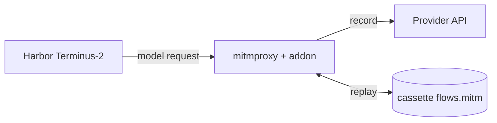

# agent-mitm-replay

Record an agent's model calls once, then replay them offline on every later run.

`agent-mitm-replay` puts a [mitmproxy](https://mitmproxy.org/) reverse proxy between the agent and the model provider. It currently drives [Harbor](https://github.com/harbor-framework/harbor) Terminus-2 trials.

- **record**: requests go to the real provider; the responses are saved to a cassette.
- **replay**: the proxy answers from the cassette. The provider is never contacted.

Use it when you want to change the task environment (filesystem, mounts, image setup) while keeping model sampling fixed. The task, container, terminal commands, verifier, and filesystem all run for real on every run. Only the model responses come from the cassette.

Replay is strict. If the agent sends a request that is not in the cassette, the proxy returns HTTP 400 and the run fails. It never falls back to the provider.



## Requirements

- Linux or macOS
- Python 3.13.x
- Docker with Compose v2, for local Harbor environments
- A model reachable through an OpenAI-compatible Chat Completions API (model names start with `openai/`)
- A provider API key, needed for `record` only

Harbor 0.24.0 and mitmproxy 12.2.3 are pinned. Their dependency ranges conflict on Python 3.12, so the project requires Python `>=3.13,<3.14`.

## Install

```bash
git clone git@github.com:l05k/agent-mitm-replay.git
cd agent-mitm-replay
uv sync --locked
```

## Quick start

### 1. Check your setup with the smoke test

```bash
uv run agent-mitm-replay smoke --output smoke-output
```

The smoke test uses a scripted local model server, so it costs no tokens. It still runs a real Harbor trial in Docker, records it, stops the fake model server, and replays offline. See [Smoke test](docs/usage.md#smoke-test) for what it checks.

### 2. Record a trial

```bash
export OPENAI_API_KEY=...
uv run agent-mitm-replay record \
  --task /path/to/task \
  --cassette cassettes/task-a \
  --model openai/gpt-4o-mini \
  --upstream https://api.openai.com \
  --artifact /app/result.txt
```

`--upstream` is an origin only, with no `/v1` or other path. Recording fails unless the trial completes without errors and reaches a reward of at least `1.0`.

### 3. Replay it offline

```bash
uv run agent-mitm-replay replay \
  --task /path/to/task \
  --cassette cassettes/task-a
```

Replay needs no API key. Model, agent options, artifacts, and extra instructions are restored from the cassette. Replay passes only when every recorded response is used exactly once and the verifier reward meets the threshold.

> [!WARNING]
> A cassette contains prompts, terminal output, file contents, and model responses. Treat it as sensitive and do not commit it unless your project allows that. See [SECURITY.md](SECURITY.md).

## Documentation

| Document | Contents |
| --- | --- |
| [Usage](docs/usage.md) | CLI options, cassette layout, success criteria, audit file, divergence testing, smoke test |
| [Comparing filesystems](docs/filesystem-comparison.md) | Replaying one recording against different mounts or Compose overlays |
| [Design and limitations](docs/design.md) | Architecture, request matching, limitations |
| [Changelog](CHANGELOG.md) | Release notes |

## Development

```bash
uv run pytest
uv run agent-mitm-replay --help
```

The tests cover the replay boundary and result validation. The end-to-end smoke test needs a running Docker daemon and is run separately.
