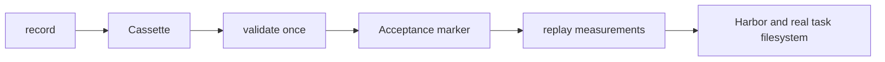

# Design and limitations

## Architecture

- `addon.py` is a framework-independent mitmproxy addon. Recording saves real provider responses. Offline operation serves a global FIFO sequence of recorded responses; request contents do not affect selection.
- `runner.py` launches the proxy and Harbor Terminus-2, saves experiment configuration, validates once, and times later Harbor invocations. Harbor itself needs no patches.
- Validation checks response consumption, trial success, and ordered command batches from Harbor's `agent/trajectory.json`. Generated call IDs and terminal output do not participate in command comparison.
- Measured replay requires the acceptance marker, but does not repeat command, reward, or full-consumption validation. The verifier still runs and contributes to elapsed time. Basic execution errors remain errors.

## Response sequencing

The Nth model call receives the Nth recorded response exactly once. Changes in body, URL, or headers do not select another response. Exhaustion returns local HTTP 400 `replay_miss`, never a provider fallback. Recorded redirects are refused with HTTP 400 `unsafe_redirect`. `connection_strategy=lazy` prevents upstream dialing while a local response is served.

Only one serial trial may use a cassette. This sequence is not an intelligent retry/matching system: an extra model call consumes the next response. There is no request-text normalization or alternate strict mode.

## Experimental boundary

A cassette represents a fixed model-response/command trajectory, not a general-purpose adaptive Agent. One successful validation is treated as acceptance for later measurements. The tool does not prove that future runs perform identical filesystem operations or produce correct task results.

The task directory and image are caller-managed. The manifest stores agent/environment options, instruction additions, artifacts, and the reward threshold. Compose files are copied; `task.toml` is a metadata snapshot. Host mount paths, task inputs, image contents, external Compose dependencies, and cache state are not bundled or reset. Restore inputs and pin environments outside the tool.

`elapsed_sec` uses a monotonic timer around the Harbor child process, including setup, verifier, artifact collection, and teardown. Proxy startup/shutdown and runner acceptance/post-processing are not timed. Harbor stage durations are reported separately, not subtracted from the total.

## Limitations

- **Single-step tasks only.** Multi-step trial results are rejected.
- **No command-completion patch.** Recorded `duration` waits remain unchanged. Slow storage can change foreground/background progress or terminal input handling, even with identical model responses.
- **No per-measurement workload validation.** Commands, verifier rewards, and unused responses are not checked again. A measured result is not a new correctness certificate.
- **No recorded model latency.** Replay returns response bytes immediately; original streaming timing is not reproduced. Compare replay runs with other replay runs.
- **No general network isolation.** Task commands/verifiers can still access the network; verifier model calls are outside this cassette. Disable or separately handle them for a controlled experiment.
- **Do not bypass the proxy.** Custom `api_base` or `llm_kwargs.base_url` options can route model calls elsewhere. The runner does not police those overrides.
- **Redirects fail.** Recording counts redirects with `Location` as errors and writes no manifest; offline operation refuses them before a client can follow them. Use the provider's final origin.
- **Trusted, immutable experiment artifacts.** Schema-1 cassettes require a fresh recording. Editing an accepted cassette/task/image does not trigger revalidation; create a new cassette for a changed experiment.
