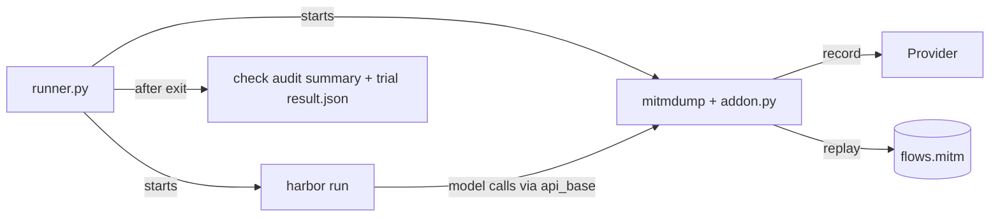

# Design and limitations

## Architecture

- `addon.py` is a mitmproxy addon with no Harbor dependency. In record mode, mitmdump saves the traffic itself (`-w flows.mitm`) and the addon writes the audit. In replay mode, the addon answers every request.
- `runner.py` starts mitmdump and `harbor run`, points Terminus-2's `api_base` at the proxy, and decides pass or fail from the audit summary and Harbor's trial result.

Harbor needs no source patches. To use the addon with another framework, route all of its model calls through the proxy and check its results yourself.

## Request matching

- A request matches a recording when the method, URL, and raw body are identical. Headers are ignored. Matching uses mitmproxy's `ServerPlayback`.
- Each recording is used at most once. Requests that match the same recording key are answered in recording order. The order across different keys is not checked.
- A request with no unused match gets HTTP 400 `replay_miss`. It is never forwarded to the provider. The runner also uses `connection_strategy=lazy`, so mitmproxy does not open a connection to the provider during replay.

## Limitations

- **One cassette per trial.** Do not share a cassette between concurrent trials.
- **Single-step tasks only.** A trial with `[[steps]]` results fails the run.
- **No general network isolation.** The runner disables Harbor telemetry and LiteLLM's price-map download. Task commands and verifiers can still reach the network unless the task's Compose file blocks it.
- **Verifier model calls are not covered.** If the verifier calls an LLM, disable it or give it its own replay setup.
- **No stream timing.** Streamed response bytes are stored, but the original timing between events is not reproduced.
- **Do not point the agent elsewhere.** Agent options such as `api_base` or `llm_kwargs.base_url` are not checked; setting them sends model calls around the proxy, and the record will be incomplete.
- **Redirects fail the run.** A 3xx response with a `Location` header is an error. In replay the agent gets HTTP 400 `unsafe_redirect` instead, so it cannot follow the redirect to the provider. In record the redirect has already reached the agent; the run fails and writes no manifest, so the cassette cannot be replayed. Use the provider's final origin.
